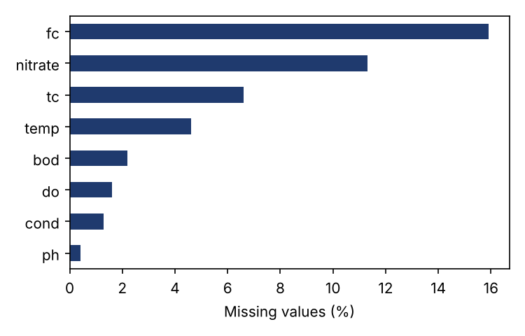
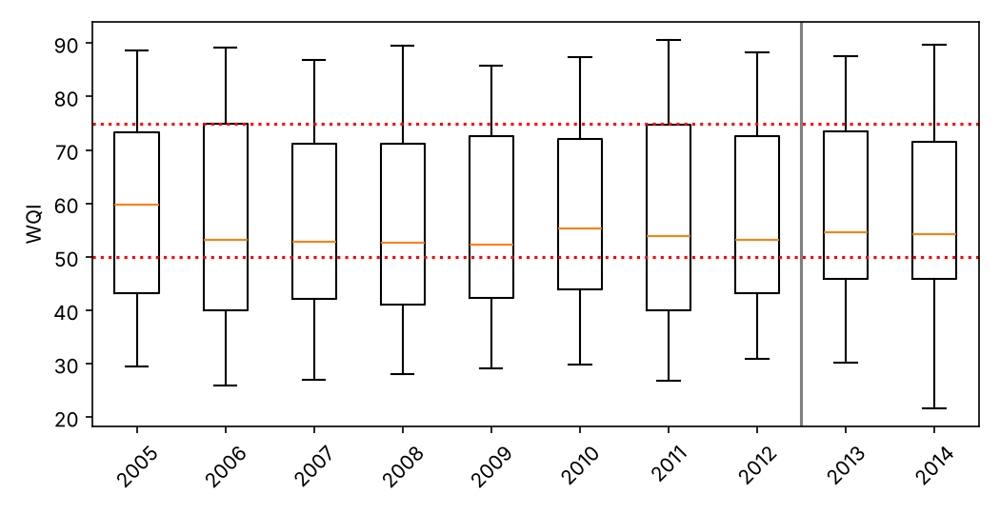
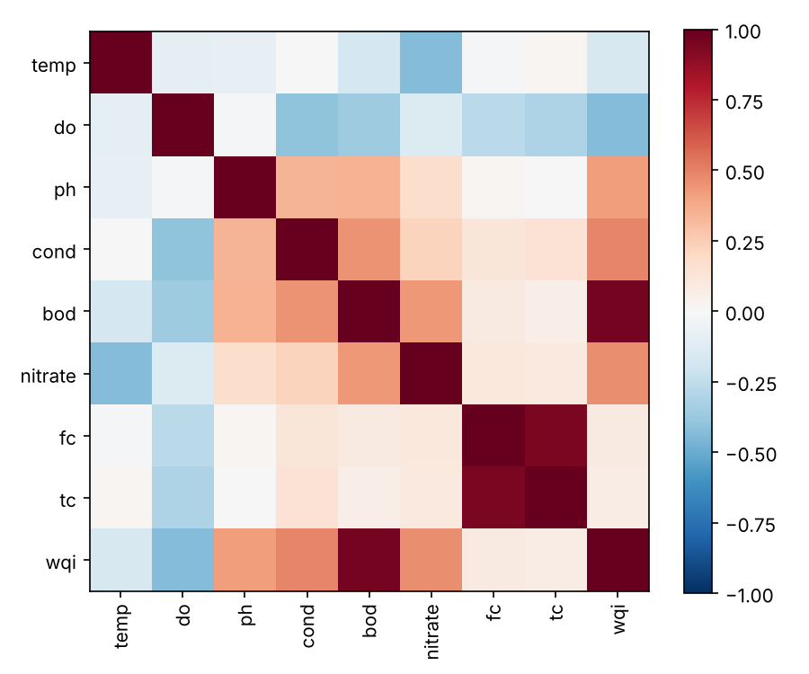
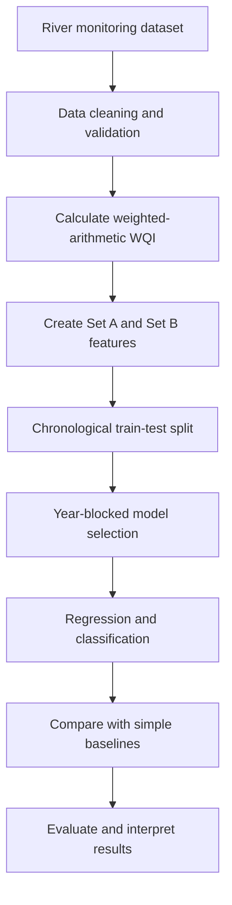
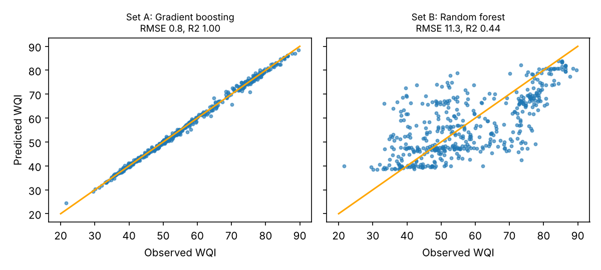
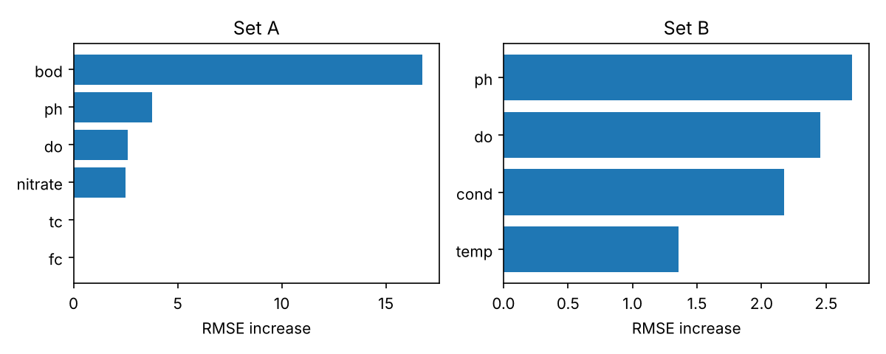

# Water Quality Index Estimation for Indian Rivers
## Machine Learning Project Report

**Student:** Aman Naveen  
**Programme:** B.Sc. Computer Science  
**Institution:** Ramanujan College, University of Delhi  
**Domain:** Water quality monitoring  
**Relevant SDGs:** SDG 6 — Clean Water and Sanitation; SDG 14 — Life Below Water

---

## Abstract

This project studies the estimation of river-water quality using a weighted-arithmetic Water Quality Index (WQI) and supervised machine-learning methods. Seven physicochemical and microbiological measurements are combined into a project-defined WQI. Regression models estimate the continuous index, while classifiers predict its three categories. Two feature sets are compared: all available measurements and a reduced set of four field measurements. A chronological holdout uses observations through 2012 for training and 2013–2014 for testing. The recorded experiment shows near-perfect performance for the full-measurement Gradient Boosting model (RMSE 0.823; R² 0.997), but this is largely a consequence of learning the formula used to construct the target. With field measurements only, the best regression model has RMSE 11.324 and is outperformed by a station-mean baseline (RMSE 7.930). These results demonstrate why baselines, leakage-aware validation, and careful interpretation are essential when evaluating environmental machine-learning systems.

**Keywords:** Water Quality Index, river monitoring, regression, classification, Random Forest, Gradient Boosting, India.

## 1. Introduction

Access to safe water is central to public health, ecological sustainability, and the achievement of SDG 6. River monitoring produces multiple measurements, but interpreting them individually can be difficult. A composite index offers a compact summary of selected measurements.

This project calculates a weighted-arithmetic WQI from Indian river-monitoring data and evaluates whether machine-learning models can estimate the index or its categories. It also examines a practical reduced-feature setting in which only temperature, dissolved oxygen, pH, and conductivity are available.

### 1.1 Objectives

- Clean and document the river-monitoring dataset.
- Calculate a weighted-arithmetic WQI from seven measurements.
- Compare regression and classification algorithms.
- Compare full-measurement and field-only feature sets.
- Evaluate models against simple baselines.
- Identify limitations affecting generalisation and operational use.

### 1.2 Research questions

1. How accurately can models reproduce the calculated WQI?
2. How much performance is lost when laboratory measurements are excluded?
3. Do machine-learning models improve on mean and station-based baselines?
4. What do the results imply about deploying such models for water-quality monitoring?

## 2. Data

### 2.1 Source and coverage

The project uses the Indian Water Quality Data dataset, distributed through Kaggle and included in the repository as `DOC-20261117-WA0000.csv`. The source file contains 1,991 records and 12 fields, covering 2003–2014.

The fields include station code, location, state, temperature, dissolved oxygen, pH, conductivity, biochemical oxygen demand, nitrate/nitrite nitrogen, faecal coliform, total coliform, and year. Field definitions and units are documented in `DATA_DICTIONARY.md`.

The source contains 1,991 records across 12 fields. After requiring complete values for all seven WQI inputs, the recorded experiment retained 1,572 observations (about 79% of the original rows). This complete-case requirement applies to WQI construction; predictive-feature imputation is handled separately inside model pipelines.

**Figure 1. Missing-value profile of the source dataset**

**Figure 2. Annual distribution of calculated WQI values**

### 2.2 Cleaning

Measurements are converted to numeric values; non-numeric tokens are treated as missing. Duplicate records are removed. pH outside the physically valid range 0–14 is marked missing. Records missing any of the seven WQI inputs are excluded from WQI calculation. Missing predictive features are imputed within model pipelines, so imputation statistics are learned from training data only.

The previously recorded full run retained 1,572 complete WQI observations. Of these, 1,111 observations through 2012 formed the training set and 461 observations from 2013–2014 formed the test set.

## 3. Methodology

### 3.1 Weighted-arithmetic WQI

For each parameter (i), the quality rating is calculated as:

`Qi = 100 × (Vi − Videal,i) / (Si − Videal,i)`

The relative unit weight is:

`Wi = K / Si,  K = 1 / Σ(1 / Si)`

The aggregate index is:

`WQI = Σ(Wi × Qi)`

The implementation uses ideal pH 7 and ideal dissolved oxygen 14.6 mg/L. Parameter standards are pH 8.5, DO 5 mg/L, BOD 3 mg/L, conductivity 2,250 µmhos/cm, nitrate/nitrite nitrogen 10 mg/L, and 500 MPN/100 mL for each coliform measure. Quality ratings are clipped to 0–100.

The nitrate and faecal-coliform limits are project assumptions and should not be represented as official CPCB designated-use limits. The resulting index is a coursework research measure, not a regulatory compliance score.

The project maps WQI ≤ 50 to Good / Excellent, WQI > 50 and ≤ 75 to Poor, and WQI > 75 to Very Poor.

### 3.2 Feature sets

- **Set A:** temperature, DO, pH, conductivity, BOD, nitrate, faecal coliform, total coliform.
- **Set B:** temperature, DO, pH, conductivity.

Set A includes the variables used in the WQI formula. Consequently, high predictive performance on Set A is expected to reflect reconstruction of the target formula. Set B tests the more constrained field-measurement use case.

**Figure 3. Spearman correlations among project variables**

### 3.3 Models and baselines

Regression models: Linear Regression, Ridge Regression, k-Nearest Neighbours, RBF Support Vector Regression, Decision Tree, Random Forest, and Gradient Boosting.

Classification models: Logistic Regression, k-Nearest Neighbours, Decision Tree, Random Forest, and Gradient Boosting.

Baselines: training-mean and station-mean regression; majority-class and station-majority classification.

### 3.4 Validation design

Observations are split chronologically: training through 2012 and testing on 2013–2014. Hyperparameters are selected with expanding year-blocked validation folds within the training period. Preprocessing is embedded in scikit-learn pipelines to prevent imputation and scaling from using test-fold statistics.

The overall workflow is summarised below.

Regression is evaluated using MAE, RMSE, and R². Classification is evaluated using accuracy and macro-F1, with confusion matrix and per-class report generated for Set A. Permutation importance is computed on the held-out test set.

## 4. Results

### 4.1 Regression

| Model | Set A RMSE | Set A R² | Set B RMSE | Set B R² |
|---|---:|---:|---:|---:|
| Mean baseline | 15.187 | -0.006 | 15.187 | -0.006 |
| Station-mean baseline | 7.930 | 0.726 | 7.930 | 0.726 |
| Linear Regression | 8.509 | 0.684 | 13.406 | 0.216 |
| Ridge Regression | 8.502 | 0.685 | 13.393 | 0.217 |
| k-NN | 6.371 | 0.823 | 11.397 | 0.433 |
| RBF SVR | 2.515 | 0.972 | 11.775 | 0.395 |
| Decision Tree | 3.012 | 0.960 | 12.640 | 0.303 |
| Random Forest | 1.851 | 0.985 | 11.324 | 0.440 |
| Gradient Boosting | 0.823 | 0.997 | 11.342 | 0.439 |

Set A Gradient Boosting produces the lowest recorded RMSE (0.823) and highest R² (0.997). Since all WQI input variables are also supplied to the model, this result primarily indicates that the model can approximate the index calculation.

For Set B, Random Forest has RMSE 11.324 and R² 0.440. The station-mean baseline has RMSE 7.930, so the field-only machine-learning regressors do not outperform this simple benchmark in the recorded experiment.

**Figure 4. Observed versus predicted WQI on the held-out data**

### 4.2 Classification

| Model | Set A accuracy | Set A macro-F1 | Set B accuracy | Set B macro-F1 |
|---|---:|---:|---:|---:|
| Majority class | 0.362 | 0.177 | 0.362 | 0.177 |
| Station-majority | 0.735 | 0.747 | 0.735 | 0.747 |
| Logistic Regression | 0.820 | 0.802 | 0.564 | 0.575 |
| k-NN | 0.768 | 0.777 | 0.642 | 0.657 |
| Decision Tree | 0.816 | 0.809 | 0.599 | 0.608 |
| Random Forest | 0.913 | 0.905 | 0.616 | 0.627 |
| Gradient Boosting | 0.933 | 0.930 | 0.657 | 0.661 |

The Set A Gradient Boosting classifier records 93.3% accuracy and 0.930 macro-F1. The earlier report contains 93.9% and 0.937; the difference is retained transparently because the current pipeline uses year-blocked hyperparameter validation.

**Figure 5. Permutation importance for the selected model**

### 4.3 Summary of findings

1. Full-measurement models can closely reproduce the constructed WQI.
2. Field-only prediction is substantially more difficult.
3. The station-mean baseline outperforms the recorded Set B regression models.
4. The model's apparent performance depends strongly on the feature set and validation design.

### Relationship to the submitted PDF

The submitted PDF is the fixed coursework document and is not modified by this repository update. Some classification scores differ slightly from the current year-blocked pipeline results. The current code and its regenerated output files should be used when demonstrating execution; the PDF's separate random 70/30 split result is not reproduced by the present script and should not be claimed as a current pipeline output.

### Secondary random-split diagnostic

A separate 70/30 random split (seed 42) is executed for the Set B Random Forest, with shuffled five-fold grid-search validation inside the random training partition. This is included only to reproduce the report's illustrative comparison; the chronological 2013–2014 holdout remains the primary evaluation. Random splitting can place records from the same station and different years in both partitions, making the result more optimistic. The exact RMSE is generated in `outputs/random_split_comparison.csv` and is not hard-coded to the submitted PDF's 9.48.

### 4.4 Main results at a glance

| Evaluation setting | Best recorded result | Interpretation |
|---|---|---|
| Set A regression | Gradient Boosting: RMSE 0.823; R² 0.997 | Strong reconstruction of the formula-derived target |
| Set B regression | Random Forest: RMSE 11.324; R² 0.440 | Limited predictive performance |
| Set B baseline comparison | Station mean RMSE 7.930 | Baseline is better than the tested Set B regressors |
| Set A classification | Gradient Boosting: 93.3% accuracy; macro-F1 0.930 | Strong category reproduction when all WQI inputs are available |

The headline scores should always be read alongside the feature-set definition and baseline comparison. In particular, the Set A score is not evidence of independent water-quality prediction.

## 5. Discussion

The contrast between Set A and Set B is the main result. A model supplied with all variables used to construct the target can learn the mathematical relationship between those variables and the WQI. This is useful as a computational approximation, but it does not demonstrate that the model can independently assess water quality.

The field-only experiment is more relevant to a low-cost monitoring scenario. Its performance is weaker, and the station-mean baseline performs better on the recorded holdout. This suggests that location-specific historical averages contain substantial predictive information and that a more complex model is not automatically better.

The station overlap between training and testing also matters: the experiment does not establish transfer to previously unseen monitoring stations. A future evaluation should hold out entire stations, in addition to holding out future years.

## 6. Limitations

- The target is formula-derived from the same measurements used in Set A.
- Most test stations also appear in training; unseen-station generalisation is untested.
- Set B regression does not beat the station-mean baseline.
- WQI weights and standards are assumptions and affect the index.
- The year-only timestamp does not support seasonal analysis.
- The dataset is secondary-source data and may contain measurement and metadata inconsistencies.
- Feature importance is predictive, not causal.
- The index should not replace official laboratory testing or regulatory assessment.

## 7. Conclusion

The project demonstrates a reproducible workflow for calculating a weighted-arithmetic WQI and comparing supervised-learning models. Full-feature models achieve very high scores, but those results are largely explained by the target's mathematical construction. The reduced field-measurement task remains challenging, and the station-mean baseline is stronger than the tested Set B regression models. These findings motivate stricter generalisation tests, more representative monitoring data, and transparent reporting of assumptions and baselines.

## 8. Future work

- Evaluate generalisation by holding out complete monitoring stations.
- Add grouped temporal validation and compare it with the current chronological split.
- Perform sensitivity analysis over WQI standards and category thresholds.
- Investigate uncertainty intervals and calibrated classification probabilities.
- Incorporate additional independent predictors such as rainfall, flow, land use, and catchment characteristics where reliable data are available.
- Validate model predictions against laboratory measurements not used to construct the WQI.

## References

1. Brown, R. M., McClelland, N. I., Deininger, R. A., & Tozer, R. G. (1970). A water quality index—do we dare? *Water & Sewage Works*, 117(10), 339–343.
2. Central Pollution Control Board. *Water quality criteria*. https://cpcb.nic.in/water-quality-criteria/
3. Pedregosa, F. et al. (2011). Scikit-learn: Machine Learning in Python. *Journal of Machine Learning Research*, 12, 2825–2830.
4. Breiman, L. (2001). Random forests. *Machine Learning*, 45, 5–32.
5. Friedman, J. H. (2001). Greedy function approximation: a gradient boosting machine. *Annals of Statistics*, 29(5), 1189–1232.

---

**Reproducibility note:** Tables above reflect the previously recorded experiment. Regenerate the pipeline and verify its outputs after any code modification before submitting this report.
